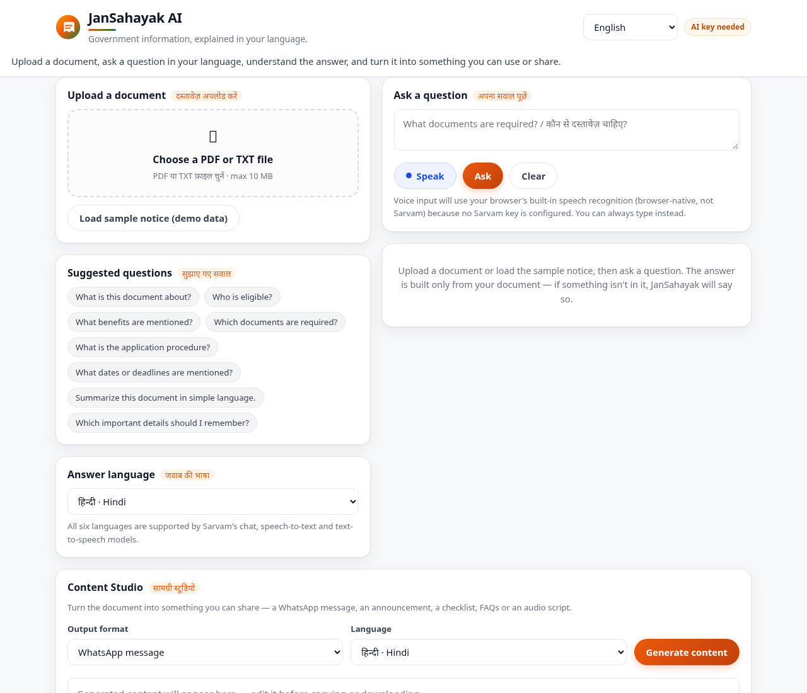
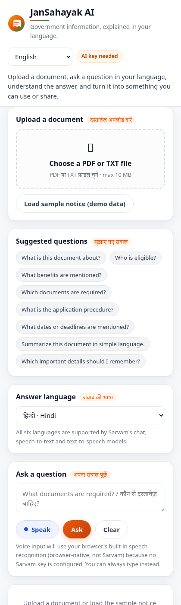

<div align="center">

# 🏛️ JanSahayak AI

### Government information, explained in your language.

**Upload a government document → ask a question in your language → understand the answer → turn it into something you can share.**

[](https://www.python.org/)
[](https://fastapi.tiangolo.com/)
[](https://docs.sarvam.ai/)
[](#-supported-languages)
[](https://www.sarvam.ai/)

<br/>



<sub>Desktop workspace — upload, ask, and listen. Mobile layout below.</sub>



</div>

---

> ⚠️ **JanSahayak AI is an independent AI tool.** It is **not** an official government service and is not affiliated with any government body. Answers are generated from the document *you* provide. Always verify important decisions, deadlines, amounts and eligibility with the relevant official source.

---

## 📖 Table of Contents

- [The Problem](#-the-problem)
- [The Solution](#-the-solution)
- [Who It's For](#-who-its-for)
- [Demo](#-demo)
- [Features](#-features)
- [Supported Languages](#-supported-languages)
- [Architecture](#-architecture)
- [Sarvam AI Integration](#-sarvam-ai-integration)
- [Tech Stack & Skills](#-tech-stack--skills)
- [API Reference](#-api-reference)
- [Project Structure](#-project-structure)
- [Getting Started](#-getting-started)
- [Environment Variables](#-environment-variables)
- [Testing](#-testing)
- [Deployment](#-deployment)
- [Security & Privacy](#-security--privacy)
- [Limitations & Roadmap](#-limitations--roadmap)
- [Credits](#-credits)

---

## 🧩 The Problem

Government notices, scheme circulars and public-service announcements are long, formal, and frequently published only in English. For a large share of Indian citizens — farmers reading agricultural scheme notices, students reading scholarship circulars, workers reading official notifications, families reading public announcements — these documents are hard to read and even harder to act on.

The people who most need the information are often the least served by the format it arrives in. Many would rather **ask a question out loud in Hindi** than parse a formal paragraph in English.

## 💡 The Solution

**JanSahayak AI** turns a document into a conversation. It does three tightly integrated things on top of **one shared pipeline**:

| Module | What it does |
|---|---|
| 🎙️ **Voice Agent** | Ask a question by voice or text in your language, get a plain-language answer, and listen to it read aloud. |
| 📄 **Document Agent** | Upload a PDF or TXT; the text is extracted and every answer is grounded **only** in that document. |
| ✍️ **Content Studio** | Turn the document into a WhatsApp message, a public announcement, a checklist, an FAQ set or an audio script. |

The uploaded document is the **single source of factual truth**. If the answer isn't in the document, JanSahayak says so — it does not invent eligibility rules, amounts, deadlines or official links.

## 👥 Who It's For

- 🧑‍🌾 **Farmers** trying to understand an agricultural scheme notice
- 🎓 **Students** reading a scholarship circular
- 🏠 **Families** reading a public-service announcement
- 👷 **Workers** reading an official notification
- 🗣️ **Anyone** who prefers speaking Hindi (or another Indian language) to typing formal English

---

## 🎬 Demo

No PDF handy? The app ships with a **bundled, fictional demonstration notice** — click **"Load sample notice (demo data)"** and it loads instantly, with no network fetch. It is clearly labelled as sample data and must not be mistaken for a real scheme.

<details>
<summary><b>Sample document (fictional)</b></summary>

> **Demonstration Scholarship Notice**
> *(This is a fictional, synthetic example. It is NOT a real government scheme.)*
>
> 1. **Purpose** — describes a scholarship for eligible students studying in a recognised school or college.
> 2. **Who can apply** — students enrolled in a recognised educational institution. The notice does **not** specify an income limit or age limit.
> 3. **Documents required** — a completed application form, proof of identity, the latest academic marksheet, and a bank-account document.
> 4. **Application procedure** — submit the completed form with all documents to the issuing institution.
> 5. **Deadline** — 30 November 2026.
> 6. **Scholarship amount** — the notice does **not** specify the amount.
> 7. **Important note** — consult the issuing institution for the final eligibility rules.

</details>

---

## ✨ Features

### 🎙️ Module A — Voice Agent
- Question input by **typing or speaking**
- Microphone button using **Sarvam Saaras** speech-to-text (recorded in the browser, transcribed server-side)
- Clearly-labelled **browser-native** speech recognition fallback when no Sarvam key is configured
- **"Listen"** button that reads the answer aloud with **Sarvam Bulbul** text-to-speech
- Answer language selector (6 languages)
- Clear loading states, friendly errors, and **no fake "recorded" state** — if nothing was captured, the app says so

### 📄 Module B — Document Agent
- **PDF and TXT** upload with drag-and-drop
- Validation of **file type** and **size** (max 10 MB) with clear error messages
- Text extraction via **`pypdf`** (PDF) and the standard library (TXT)
- **Honest handling of scanned/empty PDFs** — reports that no text was extracted instead of pretending
- Document filename, extraction status and a text preview are always visible
- **Document-grounded answers** with the source passage and page reference shown
- Explicit **"the document does not say"** behaviour instead of guessing
- Suggested questions covering eligibility, benefits, required documents, procedure, deadlines and summaries
- Long documents use bounded **passage selection**, and the app tells you whether it analysed the *full document* or *selected passages*

### ✍️ Module C — Content Studio
- Six output formats: **simple explanation, WhatsApp message, public announcement, important-points checklist, FAQ, audio-friendly script**
- Language selector, fully editable output
- **Copy** button and **Download as TXT**
- Reuses the same extraction + generation pipeline as the other modules — *one* AI system, not three

### 🎨 Experience
- Responsive layout: **two columns on desktop, one on mobile**
- Loading, empty and error states throughout — no infinite spinners
- Duplicate submissions blocked while a request is in flight
- Privacy notice and independence disclaimer
- Accessible labels, focus states and a skip link

---

## 🌐 Supported Languages

All six are covered by every Sarvam model used.

| Language | Code | Chat (`sarvam-105b`) | Speech-to-text (`saaras:v4`) | Text-to-speech (`bulbul:v3`) |
|---|---|:--:|:--:|:--:|
| Hindi | `hi-IN` | ✅ | ✅ | ✅ |
| English | `en-IN` | ✅ | ✅ | ✅ |
| Bengali | `bn-IN` | ✅ | ✅ | ✅ |
| Tamil | `ta-IN` | ✅ | ✅ | ✅ |
| Telugu | `te-IN` | ✅ | ✅ | ✅ |
| Marathi | `mr-IN` | ✅ | ✅ | ✅ |

---

## 🏗 Architecture

```
┌──────────────────────────────────────────────────────────┐
│  Browser — static SPA (index.html · styles.css · app.js) │
│  fetch() to same origin · NO API key ever in the browser │
└───────────────────────────┬──────────────────────────────┘
                            │  /api/*
┌───────────────────────────▼──────────────────────────────┐
│  FastAPI backend (backend/main.py)                       │
│   ├── documents.py      extract · in-memory store · select│
│   ├── prompts.py        grounded system prompt · formats  │
│   └── sarvam_client.py  server-side Sarvam REST calls     │
└───────────────────────────┬──────────────────────────────┘
                            │  api-subscription-key (server only)
┌───────────────────────────▼──────────────────────────────┐
│  Sarvam AI  ·  api.sarvam.ai                             │
│   sarvam-105b  ·  saaras:v4  ·  bulbul:v3                │
└──────────────────────────────────────────────────────────┘
```

**Single-origin by design:** FastAPI serves both the API and the static frontend, which eliminates CORS problems and means one deployment. The frontend is plain HTML/CSS/JS with **no build step** — a deliberate choice for reliability and speed within the hackathon time limit. It can be swapped for a Vite/React app later without changing a single API contract.

---

## 🤖 Sarvam AI Integration

All endpoints, model IDs and the auth header below are taken from the official [Sarvam AI documentation](https://docs.sarvam.ai/). Nothing here is invented.

| Capability | Endpoint | Model | Notes |
|---|---|---|---|
| Chat / Q&A / Content Studio | `POST https://api.sarvam.ai/v1/chat/completions` | `sarvam-105b` | 128K context, hybrid reasoning |
| Speech-to-text | `POST https://api.sarvam.ai/speech-to-text` | `saaras:v4` | multipart, `mode=transcribe` |
| Text-to-speech | `POST https://api.sarvam.ai/text-to-speech` | `bulbul:v3` | speaker `shubh`, base64 WAV response |

**Authentication:** the `api-subscription-key` header. Every Sarvam request is made **server-side only** — the key is never bundled into JavaScript, never returned in an API response, and never written to logs.

**Grounded prompting:** the system prompt instructs the model to use the document as the primary source, never invent eligibility/amounts/deadlines/links, distinguish what is stated from what is explained, and **ignore any instructions embedded inside the uploaded document** (the document is treated as untrusted input).

**Passage selection:** rather than a vector database, long documents are split into bounded passages and the most relevant ones are selected by keyword overlap, with the pages actually used reported back to the user.

---

## 🛠 Tech Stack & Skills

<table>
<tr><td valign="top" width="33%">

**Backend**
- Python 3.12
- FastAPI
- Uvicorn
- Pydantic
- httpx (async HTTP)
- python-multipart

</td><td valign="top" width="33%">

**Frontend**
- HTML5 · CSS3
- Vanilla JavaScript (ES2020)
- MediaRecorder API
- Web Speech API
- Responsive CSS Grid/Flexbox

</td><td valign="top" width="34%">

**AI & Data**
- Sarvam-105B (LLM)
- Saaras v4 (ASR)
- Bulbul v3 (TTS)
- pypdf (extraction)
- Prompt engineering
- Grounded generation

</td></tr>
</table>

**Engineering practices demonstrated:** server-side secret management, environment-aware API configuration, input validation, bounded resource use, graceful degradation, honest failure states, untrusted-input handling, and a tested API surface.

---

## 🔌 API Reference

| Method | Endpoint | Purpose |
|---|---|---|
| `GET` | `/api/health` | App status + which features are configured. **Never returns secrets.** |
| `GET` | `/api/demo` | Load the bundled sample notice; returns a `doc_id`. |
| `GET` | `/api/selftest` | Runs one fixed grounded question against the demo notice to prove the Sarvam AI path works. Cached for 5 minutes. |
| `POST` | `/api/documents/extract` | Validate and extract text; returns `doc_id` + metadata. |
| `POST` | `/api/ask` | Grounded answer from a `doc_id` (or raw `text`), in a chosen language. |
| `POST` | `/api/content/generate` | Generate one Content Studio format from the document. |
| `POST` | `/api/voice/transcribe` | Sarvam Saaras speech-to-text. |
| `POST` | `/api/voice/speak` | Sarvam Bulbul text-to-speech (returns WAV). |

<details>
<summary><b>Example — ask a grounded question</b></summary>

```bash
curl -X POST http://localhost:8000/api/ask \
  -H "Content-Type: application/json" \
  -d '{"question":"Which documents are required?","language":"hi-IN","doc_id":"<doc_id>"}'
```

```json
{
  "status": "ok",
  "answer": "…",
  "language": "hi-IN",
  "source_excerpt": "Applicants must submit a completed application form, …",
  "source_page": 1,
  "analysed": "full document",
  "grounded": true
}
```

</details>

---

## 📁 Project Structure

```
jansahayak-ai/
├── backend/
│   ├── main.py             FastAPI app + all routes
│   ├── sarvam_client.py    Sarvam REST client (chat · STT · TTS)
│   ├── documents.py        extraction, in-memory store, passage selection
│   ├── prompts.py          grounded system prompt + content formats
│   └── requirements.txt
├── frontend/
│   ├── index.html          single-page interface
│   ├── styles.css          responsive design system
│   └── app.js              app logic (upload, ask, voice, studio)
├── samples/
│   └── demo_scholarship_notice.txt   fictional demo data
├── tests/
│   ├── test_app.py         18 functional checks (no live server needed)
│   ├── smoke_server.py     boots real Uvicorn and hits it over HTTP
│   └── screenshot.py       renders the UI in headless Chromium
├── docs/                   README screenshots
├── render.yaml             one-click Render blueprint
├── Procfile                generic web-process start command
├── .env.example            placeholder env values only
└── .gitignore              excludes .env and build artefacts
```

---

## 🚀 Getting Started

### Prerequisites
- Python 3.11+ (3.12 recommended)
- A Sarvam API key — create one at **[dashboard.sarvam.ai](https://dashboard.sarvam.ai)** *(optional: the app runs without it, with AI features disabled)*

### 1. Clone
```bash
git clone https://github.com/AyushShah1107/jansahayak-ai.git
cd jansahayak-ai
```

### 2. Install
```bash
python3 -m venv .venv
source .venv/bin/activate        # Windows: .venv\Scripts\activate
pip install -r backend/requirements.txt
```

### 3. Configure
```bash
cp .env.example .env
# edit .env and set SARVAM_API_KEY=...
set -a; source .env; set +a      # Windows PowerShell: $env:SARVAM_API_KEY="..."
```

### 4. Run
```bash
uvicorn main:app --reload --app-dir backend --port 8000
```

### 5. Open
**http://localhost:8000** — the backend serves the frontend, so there's nothing else to start.

---

## 🔐 Environment Variables

| Variable | Required | Description |
|---|---|---|
| `SARVAM_API_KEY` | For AI features | Server-side only. Never sent to the browser. |
| `CORS_ORIGINS` | No | Comma-separated origins for split deployments. Defaults to `*`. |

`.env` is **git-ignored**. Only `.env.example` (placeholders) is committed. Without a key, the app runs fully — upload, extraction, the demo document and the whole interface work; AI actions return a clear configuration message rather than a fake answer.

---

## ✅ Testing

```bash
cd backend
python ../tests/test_app.py        # 18 functional checks, no live server needed
python ../tests/smoke_server.py    # boots real Uvicorn, hits it over HTTP
python ../tests/screenshot.py      # renders the UI headlessly
```

| # | Test | Expected result |
|---|---|---|
| 1 | `GET /api/health` | `status: ok`, no secrets in the payload |
| 2 | Load demo document | Sample notice loads, flagged as sample data |
| 3 | Extract a TXT file | Text extracted, `doc_id` returned |
| 4 | Extract a PDF file | Text extracted from each page |
| 5 | Upload a `.jpg` | `415` — unsupported file type |
| 6 | Upload a textless/blank PDF | Honest "no readable text" message (not a fake success) |
| 7 | Upload an empty file | `400` — empty file rejected |
| 8 | Ask *"Which documents are required?"* | Application form, proof of identity, latest marksheet, bank-account document |
| 9 | Ask *"What is the scholarship amount?"* | States the document does **not** specify the amount |
| 10 | Ask *"What is the deadline?"* | 30 November 2026, noted as stated in the notice |
| 11 | Ask with an unknown `doc_id` | `404` |
| 12 | Ask with an unsupported language | `400` |
| 13 | Generate a WhatsApp message in Hindi | Concise Hindi message, no invented facts |
| 14 | Generate with an unsupported format | `400` |
| 15 | Voice speak / transcribe without a key | Clear `503` configuration error, no crash |
| 16 | Fetch `/` | Frontend served, title present |
| 17 | Inspect the served JS | No API-key pattern present in the bundle |
| 18 | Run without `SARVAM_API_KEY` | Interface and non-AI features fully usable |

**Verified in this build:** all 18 checks pass, the real Uvicorn server was booted and hit over HTTP, and the UI was rendered and reviewed at desktop (1280 px) and mobile (420 px) widths.

**Live deployment check:** `GET /api/selftest` on the deployed app runs one fixed question (*"Which documents are required?"*) through Sarvam-105B and returns the answer, giving a one-request proof that the AI path and API key work in production.

> **Note on live AI testing:** the AI path *is* verified live against the deployed app — `GET /api/selftest` returns a real Sarvam-105B answer grounded in the demo notice. In the build sandbox no key was available, so the local suite exercises the non-AI paths (upload, extraction, validation, static serving); set `SARVAM_API_KEY` locally to run the AI paths in the suite too.

---

## ☁️ Deployment

The app is a **single FastAPI service** (API + static frontend), so any host that runs a Python web process works.

### Option 1 — Render Blueprint (one click)

`render.yaml` is committed, so Render configures everything for you.

1. Push this repo to GitHub.
2. Sign up at **[render.com](https://render.com)** (free tier, no card required).
3. **New → Blueprint → connect GitHub → select this repository.**
4. When prompted, set **`SARVAM_API_KEY`** (this is the only value you need to supply).
5. Deploy. Render builds with `pip install -r backend/requirements.txt` and starts `uvicorn main:app --host 0.0.0.0 --port $PORT --app-dir backend`.
6. Verify: open `https://<your-service>.onrender.com/api/health` → `{"status":"ok", ...}`.

### Option 2 — Any Python host (Railway, Fly.io, a VPS…)

| Setting | Value |
|---|---|
| Build | `pip install -r backend/requirements.txt` |
| Start | `uvicorn main:app --host 0.0.0.0 --port $PORT --app-dir backend` |
| Env | `SARVAM_API_KEY=<your key>` |

A `Procfile` with the correct start command is included.

### Option 3 — Split frontend / backend

Host the backend as above, then set `window.JANSAHAYAK_API_BASE` to the backend URL before `app.js` loads, and set `CORS_ORIGINS` on the backend to your frontend origin.

> ⚠️ Never point a production frontend at `localhost`, and never put the API key in a frontend environment variable — anything prefixed for the browser bundle is public.

---

## 🔒 Security & Privacy

- 🔑 The Sarvam API key lives **only** in server-side environment variables.
- 🚫 Never committed: `.env` is git-ignored; `.env.example` contains placeholders only.
- 📤 The key is never bundled into browser JavaScript, returned in a response, or written to logs.
- 📏 Uploads are validated by type and size; oversized files are rejected.
- 🧠 Documents are processed **in memory** and expire automatically (1 hour) — no permanent storage.
- 🛡️ Uploaded documents are treated as **untrusted input**; the system prompt instructs the model to ignore instructions embedded inside a document.
- 🙅 The app never claims a benefit was approved or an application submitted, and prompts users to verify high-impact details with the official source.
- 🔏 Users are advised not to upload unnecessary sensitive personal information. When AI features are used, the relevant document text is sent to Sarvam AI to generate the response.

---

## ⚠️ Limitations & Roadmap

**Known limitations**
- Scanned image PDFs are **not** OCR'd — the app reports that no text was extracted rather than pretending otherwise. *(Sarvam Vision OCR is a natural next step.)*
- Long-document retrieval uses simple keyword-overlap passage selection, not embeddings/RAG.
- Documents live in memory and expire after one hour; they are not persisted.
- The interface-language toggle only partially relabels the static UI (the **response** language is fully supported across all six languages).
- The frontend is plain HTML/CSS/JS rather than React — a deliberate trade-off for reliability within the time limit.

**Roadmap**
- [ ] Sarvam Vision OCR for scanned documents
- [ ] Embedding-based retrieval for very long documents
- [ ] Full UI translation of every label
- [ ] React/Vite frontend on the same API
- [ ] Optional voice-first conversational loop

---

## 🙏 Credits

- **[Sarvam AI](https://www.sarvam.ai/)** — Sarvam-105B, Saaras v4 and Bulbul v3 power the text, speech-to-text and text-to-speech capabilities. See the [API docs](https://docs.sarvam.ai/).
- Built with **[FastAPI](https://fastapi.tiangolo.com/)**, **[Uvicorn](https://www.uvicorn.org/)** and **[pypdf](https://pypdf.readthedocs.io/)**.

<div align="center">

---

**Built for the Sarvam AI Hackathon.**

*JanSahayak AI is an independent project and is not an official government service.*

</div>
